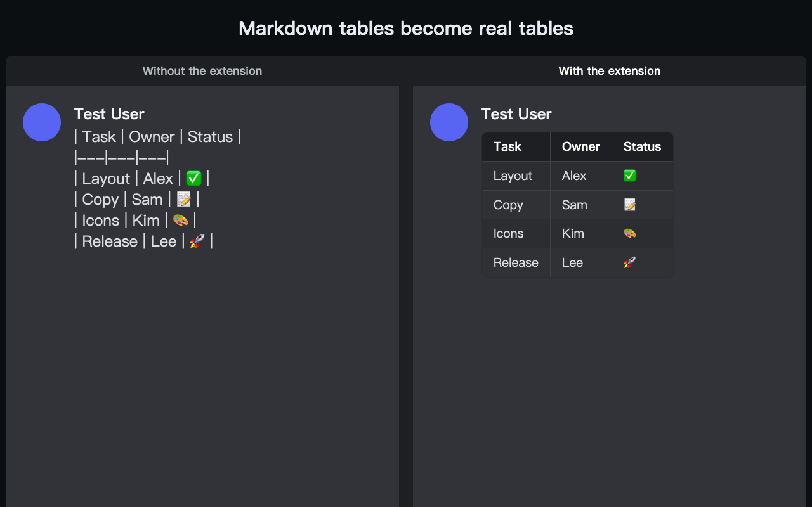
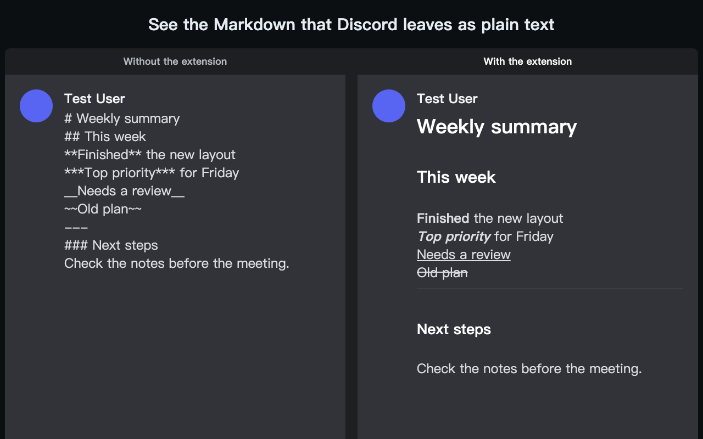
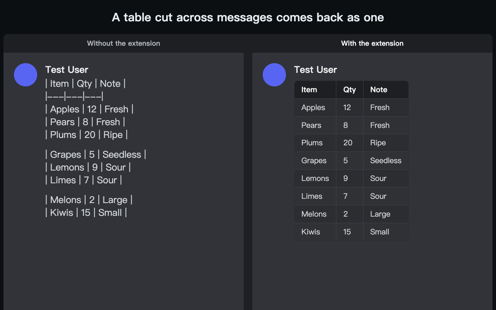

<p align="center">
  
</p>

<h1 align="center">Discord Markdown Renderer</h1>

<p align="center">
  <b>See the Markdown tables, headings and formatting that Discord leaves as plain text.</b><br>
  A Chrome extension for Discord on the web, with no settings and no extra permissions.
</p>

<p align="center">
  English · <a href="README.zh-TW.md">繁體中文</a>
</p>

<p align="center">
  <a href="https://chromewebstore.google.com/detail/mhbajdapdopnfhgpoodifpogfjaghaha">Chrome Web Store</a> · <a href="https://gist.github.com/xxxxDev/d7452492a2183116736735b6cf417926">Console script on Gist</a>
</p>

<p align="center">
  
</p>

<p align="center">
  
</p>

<p align="center">
  
</p>

---

## What it is

Discord does not render Markdown tables, and stray characters can break other formatting. This extension fixes the display in your browser. Only your own view changes: other people see the same messages as before.

## Features

- Tables, including a table Discord has cut across several messages
- `---` horizontal lines
- `**bold**`, `***bold italic***`, `__underline__` and `~~strike~~`
- `#`, `##` and `###` headings
- Long text that Discord wrongly wraps in one code or italic block

## Install

The extension is on the [Chrome Web Store](https://chromewebstore.google.com/detail/mhbajdapdopnfhgpoodifpogfjaghaha). Install it, then reload Discord.

To run it from this repository:

1. Open `chrome://extensions/` and turn on **Developer mode**.
2. Choose **Load unpacked** and select the `discord-markdown-renderer-extension` folder.
3. Reload Discord.

## Use it

Send this in any channel:

```
| File | Note |
|---|---|
| a.md | First |
| b.md | Second |
```

You should see a table in place of the raw text.

### Without installing

You can paste the script into the DevTools Console instead. It stops working when you reload Discord, so paste it again after that.

1. Open Discord, in a browser or in the desktop app (an Electron app with the same DevTools), and open the DevTools Console.
2. Paste all of `inject_console.js`, or copy the script from the [Gist](https://gist.github.com/xxxxDev/d7452492a2183116736735b6cf417926), and press Enter.
3. You should see `[discord-markdown-renderer] injected v2026.11.2`.

Read a script before you paste it: anything run in the Console can access your Discord session.

## Limits

- A cell cannot span several lines.
- Column alignment such as `:---:` is accepted but ignored.
- A table inside a code block is rendered too.
- Single `*italic*` and `_italic_` are left to Discord, because they clash with paths such as `*.xlsx`.
- You may see a brief flicker when you switch channels.
- A row cut across messages can go blank for a moment when Discord redraws the earlier message.

## How it works

The script watches the message list, finds Markdown in the visible text, hides the original text and places the rendered result beside it. It does not change Discord's own structure, so it can safely run again when Discord redraws a message.

The extension's logic is in `discord-markdown-renderer-extension/content_script.js`. `inject_console.js` is the same logic with its styles included and cleanup for repeat pastes. Version history is in the GitHub releases.

## Privacy and permissions

The extension runs only on Discord's web pages. It asks for no extra permissions, makes no network requests and stores nothing. See [SECURITY.md](SECURITY.md).

## Contributing

See [CONTRIBUTING.md](CONTRIBUTING.md). For a security problem, see [SECURITY.md](SECURITY.md).

## License

The code is under the [MIT License](LICENSE). The icon isn't: see [BRAND.md](BRAND.md).

Discord Markdown Renderer is an independent project. It is not made by, affiliated with or endorsed by Discord. Discord is a trademark of Discord Inc.

Made by [V-AX](https://v-ax.com).
