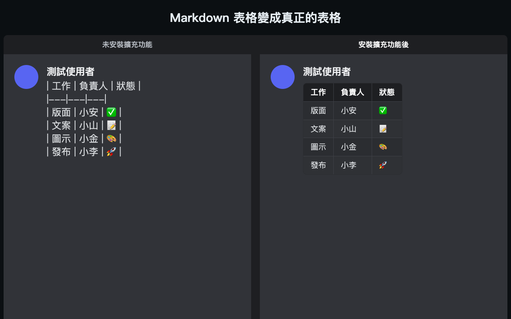
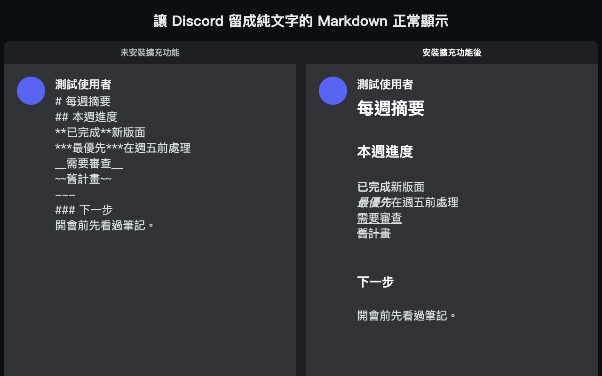
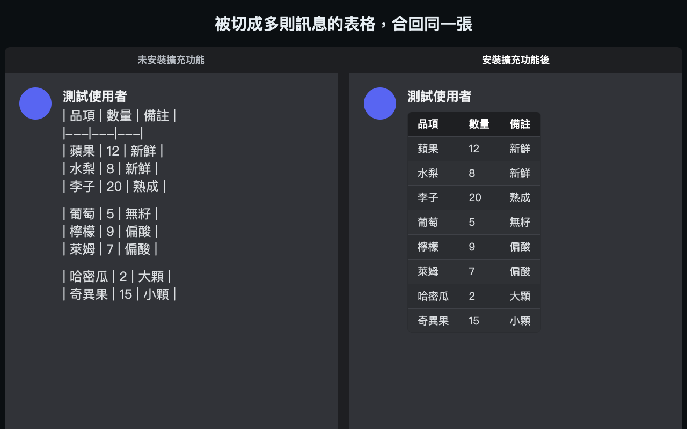

<p align="center">
  
</p>

<h1 align="center">Discord Markdown Renderer</h1>

<p align="center">
  <b>讓 Discord 留成純文字的 Markdown 表格、標題和格式正常顯示。</b><br>
  用於網頁版 Discord 的 Chrome 擴充功能，不用設定，也不要求額外權限。
</p>

<p align="center">
  <a href="README.md">English</a> · 繁體中文
</p>

<p align="center">
  <a href="https://chromewebstore.google.com/detail/mhbajdapdopnfhgpoodifpogfjaghaha">Chrome 線上應用程式商店</a> · <a href="https://gist.github.com/xxxxDev/d7452492a2183116736735b6cf417926">Gist 上的 Console 腳本</a>
</p>

<p align="center">
  
</p>

<p align="center">
  
</p>

<p align="center">
  
</p>

---

## 這是什麼

Discord 不會渲染 Markdown 表格，零散的符號也可能讓其他格式跑掉。這個擴充功能會在你的瀏覽器裡修正顯示。只有你自己看到的畫面會改變，其他人看到的訊息不變。

## 功能

- 表格，包含被 Discord 切成多則訊息的表格
- `---` 水平線
- `**粗體**`、`***粗斜體***`、`__底線__` 和 `~~刪除線~~`
- `#`、`##` 和 `###` 標題
- 被 Discord 誤包成一整段程式碼或斜體的長文字

## 安裝

可以到 [Chrome 線上應用程式商店](https://chromewebstore.google.com/detail/mhbajdapdopnfhgpoodifpogfjaghaha)安裝，裝好後重新載入 Discord。

想直接從這個 repo 執行：

1. 開啟 `chrome://extensions/`，打開「**開發人員模式**」。
2. 選「**載入未封裝項目**」，選擇 `discord-markdown-renderer-extension` 資料夾。
3. 重新載入 Discord。

## 使用方式

在任何頻道傳送這段：

```
| 檔案 | 說明 |
|---|---|
| a.md | 第一個 |
| b.md | 第二個 |
```

原始文字的位置應該會變成表格。

### 不安裝也能用

也可以把腳本貼到 DevTools Console。重新載入 Discord 後就會失效，到時候再貼一次即可。

1. 在瀏覽器或桌面版（Electron，同樣有 DevTools）開啟 Discord，再開啟 DevTools Console。
2. 貼上整份 `inject_console.js`，或複製 [Gist](https://gist.github.com/xxxxDev/d7452492a2183116736735b6cf417926) 上的腳本，然後按 Enter。
3. 應該會看到 `[discord-markdown-renderer] injected v2026.11.2`。

貼上前請先看過腳本：在 Console 執行的任何內容都能存取你的 Discord 工作階段。

## 限制

- 一個儲存格不能跨多行。
- 可以寫 `:---:` 這類對齊符號，但不會套用對齊。
- 程式碼區塊裡的表格也會被渲染。
- 單個 `*斜體*` 和 `_斜體_` 交給 Discord 處理，因為會和 `*.xlsx` 這類路徑衝突。
- 切換頻道時可能短暫閃動。
- 跨訊息切斷的那一列，在 Discord 重畫前一則訊息時可能短暫變成空白。

## 運作方式

腳本會監看訊息列表，從看得到的文字裡找出 Markdown，隱藏原文並在旁邊放上渲染結果。它不改 Discord 本身的結構，所以 Discord 重畫訊息時可以安全地再跑一次。

擴充功能的邏輯在 `discord-markdown-renderer-extension/content_script.js`。`inject_console.js` 是相同的邏輯，另外內含樣式和重複貼上時的清理。版本紀錄在 GitHub releases。

## 隱私與權限

這個擴充功能只在 Discord 網頁上執行。它不要求額外權限、不發出網路要求，也不儲存任何資料。詳情請看 [SECURITY.md](SECURITY.md)。

## 參與貢獻

請看 [CONTRIBUTING.md](CONTRIBUTING.md)。資安問題請看 [SECURITY.md](SECURITY.md)。

## 授權

程式碼以 [MIT License](LICENSE) 釋出。圖示不在此授權內，見 [BRAND.md](BRAND.md)。

Discord Markdown Renderer 是獨立專案，並非由 Discord 製作，也與其沒有關係或背書。Discord 是 Discord Inc. 的商標。

由 [V-AX](https://v-ax.com) 製作。
